<picture>
  <source media="(prefers-color-scheme: dark)" srcset="assets/header-dark.svg">
  <source media="(prefers-color-scheme: light)" srcset="assets/header-light.svg">
  
</picture>

Hi, I’m Sainyam. I build the evaluation, data, and inference systems that turn frontier foundation models into reliable products.

By day I lead that work at Amazon Nova, and most of it is internal. There’s more about it [on my website](https://sainyam.me/).

[Website ↗](https://sainyam.me/) &nbsp;·&nbsp; [Blog ↗](https://blog.sainyam.me/) &nbsp;·&nbsp; [LinkedIn ↗](https://linkedin.com/in/sainyamkapoor) &nbsp;·&nbsp; [Résumé ↗](https://link.sainyam.me/resume) &nbsp;·&nbsp; [hello@sainyam.me](mailto:hello@sainyam.me)

<a href="https://github.com/saikpr?tab=repositories">All repositories →</a>

